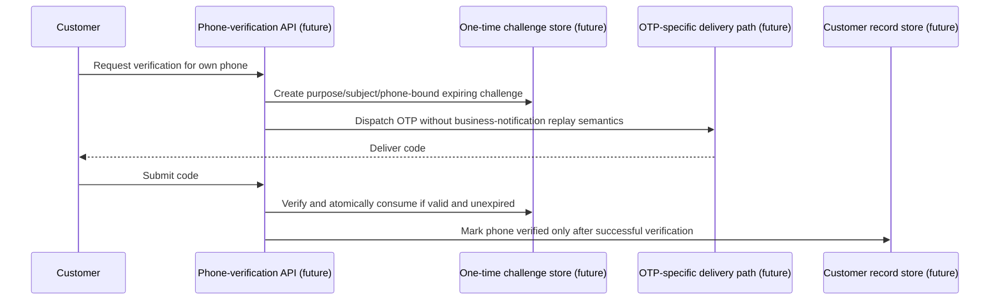

# SMS and OTP Flows

**Status:** Business-notification SMS is implemented. Arkesel V2 external verification remains unresolved. Africa's Talking standard SMS support is implemented but has not been externally verified; two sandbox requests returned HTTP 401 without provider message IDs, and no further requests should be made until support diagnoses authorization. Twilio Programmable Messaging is implemented as an explicitly selectable provider but has not been externally tested; no Twilio API request or database migration was made. Twilio and Africa's Talking delivery callbacks are not ingested, so accepted messages remain `SENT`. Phone-verification OTP is not implemented; the OTP section below records the intended boundary and design constraints, not a live API or flow.

## 1. Business-notification SMS

Business SMS reports completed ShopCity actions; they are not authentication factors.

```mermaid
sequenceDiagram
    participant Domain as Business service
    participant DB as Postgres
    participant Publisher as Outbox recovery/publisher
    participant Queue as BullMQ
    participant Worker as Outbox worker
    participant Provider as SMS provider

    Domain->>DB: Commit business change + sms.send event
    Note over DB: A SmsMessage may be created in the same transaction;
    Note over DB: the worker can reconstruct/upsert it during recovery.
    Publisher->>DB: Read due outbox events
    Publisher->>Queue: Publish with outbox event ID as job ID
    Queue->>Worker: Deliver sms.send job
    Worker->>DB: Validate versioned template/payload; upsert SmsMessage
    Note over Worker,DB: Twilio first claims a local tenant/outbox reservation
    Worker->>Provider: Send rendered message with outbox correlation
    Provider-->>Worker: Accepted/failed result and optional provider ID
    Worker->>DB: Persist normalized status, attempt and provider ID
    Note over Worker,Provider: Separate paced DLR polling may later confirm delivery
```

### Flow details

1. A business transaction creates a versioned `sms.send` outbox event for a supported notification. Common producers include loyalty earn/redemption, reversals, adjustments, card replacement, and credit-expiry reminders. Some producers create the `SmsMessage` row in the same transaction; recovery can reconstruct it from the event if needed.
2. The outbox publisher uses the event ID as the BullMQ job ID. The worker validates the payload and template before sending. Invalid or unsupported events become observable terminal/dead-letter outcomes rather than being sent with guessed content.
3. The worker renders the business template and calls the configured `SmsProvider`. Current templates are `earn-confirmed`, `redemption-confirmed`, `transaction-reversed`, `balance-adjusted`, `card-replaced`, and `credit-expiry-reminder-v1`.
4. `SMS_PROVIDER_VENDOR` defaults to `ebulksms`; `arkesel`, `africastalking`, and `twilio` are explicitly selectable. `SMS_PROVIDER_MODE=deterministic` and the generic `sandbox` mode are test providers. Arkesel's `ARKESEL_SANDBOX=true` and Africa's Talking's `AFRICASTALKING_SANDBOX=true` are separate non-production external sandboxes with separate credentials. Arkesel requests use the server-side `api-key`, `use_case: transactional`, and the digits-only international recipient in the nested recipient-array shape required by the supplied V2 schema. Africa's Talking uses its standard form-encoded `/version1/messaging` endpoint, with the fully rendered text and explicit sender ID in live mode. Twilio uses the official Node SDK with Account SID plus API Key SID/Secret and exactly one configured E.164 `From` number or Messaging Service SID. Never reuse provider credentials.
5. For real providers, acceptance is recorded as `SENT`, not as handset delivery. `DELIVERED` is written only after recognized delivery evidence for the matching provider message ID. Arkesel `SUBMITTED`/`QUEUED` remain `SENT`; `NOT_DELIVERED`, `PROHIBITED`, and `EXPIRED` map to `FAILED`. Africa's Talking status codes `100`, `101`, and `102` mean processed/sent/queued and map only to `SENT`; its later DLR callback is not currently ingested. Twilio message creation returns an acceptance SID but no delivery evidence, and status callbacks are not currently ingested, so Twilio messages remain `SENT`. The deterministic test provider can return synthetic outcomes outside production; production startup rejects it.
6. Delivery-report polling runs on its own paced schedule (default five minutes, batch ten), claims due rows before requesting reports, and leaves unresolved messages eligible for a later poll. Retryable send failures use the outbox retry path; terminal failures and exhausted attempts are dead-lettered.

### Provider and data boundaries

- eBulkSMS remains the default. Arkesel sandbox requests are non-delivering/non-billable provider tests; they are not evidence of handset delivery. No successful external Arkesel acceptance has been confirmed; prior attempts returned errors without message IDs. Do not retry until the validation/internal error is diagnosed. Africa's Talking sandbox uses a separate API key and simulator; no Africa's Talking request has been sent from ShopCity.
- Provider adapters retain normalized status, provider reference, and relevant timestamps—not raw provider responses. Never log or paste API keys, OTP codes, full phone numbers, message bodies, or raw provider payloads. Operational views must mask destination numbers.
- The Twilio Messages create request has no documented provider-side idempotency key. Before dispatch, the worker claims a local compare-and-set reservation for the tenant/outbox event. A concurrent job cannot submit while the reservation is fresh; recovery turns a stale reservation into a terminal outcome-unknown dead letter. Check Twilio history before any manual replay. Only explicit HTTP 429 is automatically retryable; transport failures, timeouts, malformed successes, and HTTP 5xx are terminal/ambiguous.
- Africa's Talking sandbox attempts returned HTTP 401 without provider message IDs; authorization remains unresolved. Do not retry until provider support diagnoses the credentials/endpoint authorization. No successful external acceptance has been verified.
- Business-notification SMS may be durable and replayable because it represents a completed business event. That property is intentionally unsuitable for OTP secrets.

## 2. Authentication and OTP boundary

### Current authentication

There is no phone OTP in the current authentication flow. Password verification uses Supabase Auth; ShopCity creates and manages application sessions. For a WebAuthn-bound Cashier device, `POST /api/v1/auth/login` verifies the password and returns `DEVICE_ASSERTION_REQUIRED` with a short-lived, single-use attempt and assertion options—but no ShopCity session. `POST /api/v1/auth/cashier-login/complete` verifies the WebAuthn assertion, rechecks user/device/credential/branch eligibility, consumes the attempt, and then issues a session bound to both the device and credential. Supervisor/Admin login remains on its existing password/session path. OTP must not become a fallback for cashier WebAuthn.

### Future customer phone-verification OTP — not implemented

No customer phone-OTP issue, verify, resend, challenge-store, or OTP SMS-template flow exists in the current source. When phone verification is approved and specified, keep it distinct from the business-notification flow:



Required design constraints for that future work:

- Bind a challenge to its purpose, subject, and normalized phone number; expire it, limit verification/resend attempts, and consume it atomically once. Exact TTLs, limits, storage, routes, and recovery behavior require an OpenSpec change before implementation.
- Keep OTP generation, challenge state, delivery, and verification out of the ordinary `sms.send` business-event templates and replay path. If asynchronous delivery is needed, give OTP its own purpose-specific delivery and expiry/retry policy.
- Never store or log plaintext OTP values. A provider DLR proves only provider delivery status; it does not verify ownership of the phone number.
- Do not change cashier WebAuthn/device binding or treat OTP as an authentication fallback. OTP scope here means future customer phone-number verification unless separately approved.

## References

- Runtime: `src/jobs/outbox.publisher.ts`, `src/jobs/outbox-worker.runtime.ts`, `src/jobs/sms.provider.ts`, `src/jobs/sms.provider.factory.ts`, `src/jobs/sms.templates.ts`
- Authentication: `src/modules/auth/auth.controller.ts`, `src/modules/auth/auth.service.ts`
- Operations: `docs/runbooks/sms-operations.md`
- Contracts: `openspec/specs/sms-delivery-truthfulness/spec.md`, `openspec/specs/sms-operations/spec.md`, and `docs/TRD.md` sections 13.3 and 14.1
